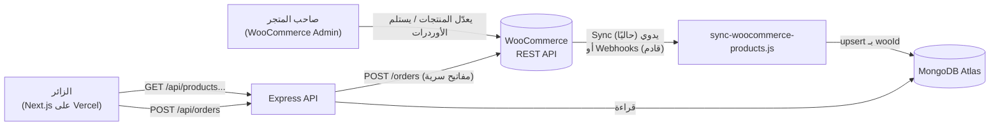

# 01. المعمارية العامة

## المبدأ الأساسي
> **WooCommerce هو مصدر الحقيقة. MongoDB نسخة قراءة سريعة منه. المتصفح عمره ما بيكلّم WooCommerce.**

صاحب المتجر بيدير المنتجات والأسعار والأوردرات من لوحة WooCommerce، وإحنا مش بنطلب منه يتعلم نظام تاني ("Method B" في [`09-decisions.md`](09-decisions.md) D-01).

## الرسم العام


## مسارات البيانات
| المسار | الاتجاه | الوسيلة | الحالة |
|---|---|---|---|
| المنتجات (اسم/سعر/صور/وصف/شيدات) | WooCommerce → MongoDB | `sync-woocommerce-products.js` (يدوي) | ✅ |
| عرض الكتالوج | MongoDB → المتصفح | `GET /api/products*` | ✅ |
| الأوردر | المتصفح → Express → WooCommerce | `POST /api/orders` | 🧪 |
| تحديث المخزون/السعر لحظيًا | WooCommerce → MongoDB | Webhooks | ❌ مش مبني |

## هيكل المشروع
```
project/
├── frontend/                 Next.js 14 (App Router)
│   ├── app/                  الصفحات (/, /shop, /product/[slug], /checkout, /about, /contact, /login)
│   ├── components/           UI (sections/, ui/)
│   ├── lib/                  useProducts, pricing, categories, buildShopHref, slugify, getProduct (server)
│   ├── store/useCartStore.js السلة (Zustand + persist)
│   └── data/nav.js           قوائم الـ Navbar/Mega menu
├── server/                   Express + Mongoose
│   ├── src/index.js          نقطة الدخول (middleware + routes)
│   ├── src/routes/           products.js, orders.js
│   ├── src/models/           Product.js, Order.js
│   ├── src/services/         orderService.js (منطق الأوردر)
│   ├── src/validators/       orderInput.js
│   ├── src/lib/              woo.js, wooCategoryMap.js, shadeTones.js, slugify.js
│   ├── src/scripts/          sync + سكريبتات تشخيص
│   ├── src/seed/             بيانات ديمو قديمة (للحذف)
│   └── test/                 اختبارات node:test
└── docs/                     التوثيق ده
```

## البيئات والمتغيرات
| المتغير | أين | الغرض |
|---|---|---|
| `MONGODB_URI` | server | اتصال Atlas |
| `PORT`, `CLIENT_ORIGIN` | server | البورت، وعناوين الفرونت المسموحة لـ CORS (مفصولة بفاصلة) |
| `WC_URL`, `WC_CONSUMER_KEY`, `WC_CONSUMER_SECRET` | server | WooCommerce (المفتاح **Read/Write** عشان الأوردرات) |
| `SHIPPING_FEE`, `WC_ORDER_STATUS` | server | رسوم الشحن (60)، حالة الأوردر عند الإنشاء (`processing`) |
| `TRUST_PROXY` | server | `1` خلف proxy (للـ rate limit) |
| `FORCE_GOOGLE_DNS` | server | محلي فقط، حل مشكلة DNS في الـ sandbox |
| `NEXT_PUBLIC_API_URL` | frontend | عنوان الـ API من المتصفح (بيتدمج وقت الـ build) |
| `API_URL` | frontend | عنوان الـ API من سيرفر Next (صفحة المنتج كـ Server Component) |
| `IMAGE_HOSTS` | frontend | دومينات الصور المسموحة لـ `next/image` |

القوالب: `server/.env.example` و`frontend/.env.local.example`. الأسرار ما بتترفعش على Git أبدًا.

## مبادئ مشتركة في الكود
- **الأسعار بتتحسب في السيرفر**: العميل بيبعت id/شيد/كمية بس.
- **الفلترة على حقول indexed** (`category`, `department`, `brandSlug`, `effectivePrice`...) مفيش collection scan ولا regex عشوائي.
- **المصدر الواحد لكل منطق**: `lib/pricing.js` (سعر الاختيار)، `lib/buildShopHref.js` (روابط /shop)، `ProductImage.jsx` (عرض الصور)، `wooCategoryMap.js` (التصنيف).
- **الفشل بوضوح**: متغير بيئة ناقص في production بيطلّع error مفهوم، مش fallback صامت.
