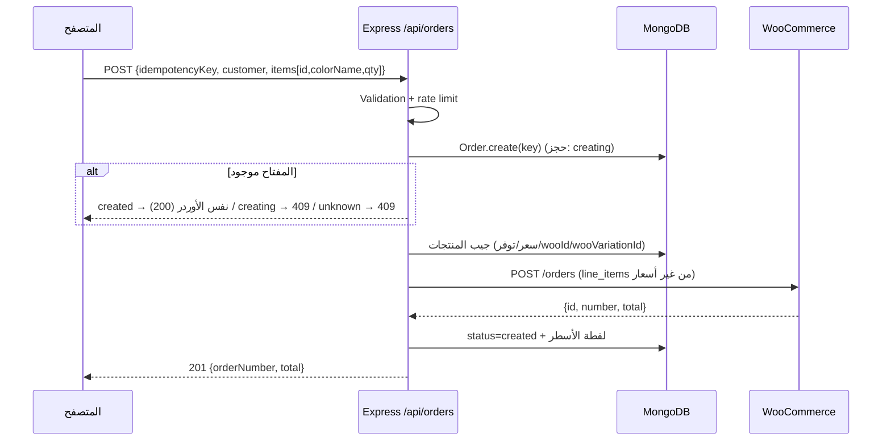

# 04. السلة والـ Checkout والأوردرات

**الكود:** `frontend/store/useCartStore.js`, `frontend/lib/pricing.js`, `frontend/app/checkout/page.jsx`
`server/src/routes/orders.js`, `services/orderService.js`, `validators/orderInput.js`, `lib/woo.js`, `models/Order.js`

**الحالة:** 🧪 المنطق مختبر بـ 11 اختبار وحدة (بدون Mongo/WooCommerce حقيقيين). **أول أوردر تجريبي على الـ staging لسه ⏳.**

## السلة (Zustand + `persist`)
- **هوية سطر السلة** `lineId = productId` أو `productId:colorName`. شيدين مختلفين من نفس المنتج = سطرين.
- السطر بيخزّن حقول العرض بس: `lineId, id, name, slug, colorName, price, salePrice, tone, image, qty`. الحد الأقصى للكمية 99.
- `addItem(product, qty = 1)`: استدعاء واحد (set واحد + كتابة واحدة في localStorage).
- بيتخزّن `items` فقط (`partialize`)، و`isOpen` لأ (الـ drawer ما يفتحش لوحده بعد refresh).
- `version: 1` + `migrate`: سلات قديمة من غير `lineId` بتتحوّل تلقائيًا.
- `lib/pricing.js → resolvePricing(product, variant)`: **المصدر الوحيد** لسعر الاختيار المحدد (سعر الشيد لو ليه، وإلا سعر المنتج). بيستخدمه `ProductMain` (العرض) و`ProductCard` (الإضافة للسلة).

## الـ Checkout (`/checkout`)
- الحقول: الاسم، الموبايل (باترن مصري `01[0125]xxxxxxxx` بكل صيغه)، المدينة، العنوان. Validation على العميل ثم تاني على السيرفر.
- الشحن **60 جنيه ثابت**: `SHIPPING_FEE` في الـ checkout و`SHIPPING_FEE` في `server/.env`، **لازم يتطابقوا** (مؤقت لحد مناطق شحن حقيقية).
- `submitOrder()` هو **المكان الوحيد** اللي بيكلّم الـ API. بيبعت `id + colorName + qty` بس (**مفيش أسعار**).
- حماية من الضغط المزدوج: `idempotencyKey` لكل "محاولة". نفس البيانات = نفس المفتاح (إعادة محاولة آمنة)، أي تعديل في الفورم/السلة = مفتاح جديد.
- عند النجاح: يمسح السلة ويعرض رقم الأوردر.

## التدفق

## الـ Contract
**Request:** `{ idempotencyKey (16–64 حرف [A-Za-z0-9_-]), customer: {name, phone, city, address}, note?, items: [{id, colorName|null, qty}] }`
**Success:** `201 {orderNumber, total}` (أو `200` لو إعادة لنفس الأوردر).
**Error:** `{ error: "رسالة للعميل", code, fields? | items? }`

| Status | `code` | المعنى |
|---|---|---|
| 400 | `VALIDATION` | بيانات غلط (`fields` فيه الحقول) |
| 409 | `UNAVAILABLE` | منتج/شيد مش متاح أو منتج ديمو (`items` فيها التفاصيل والسبب) |
| 409 | `KEY_REUSED` | نفس المفتاح بسلة مختلفة |
| 409 | `IN_PROGRESS` | الأوردر لسه بيتعالج |
| 409 / 502 | `ORDER_UNCERTAIN` | WooCommerce ما ردّش: الأوردر **ممكن يكون اتعمل**، لا تعيد المحاولة |
| 502 | `ORDER_REJECTED` | WooCommerce رفض صراحة (4xx) |
| 502 | `ORDER_UNCERTAIN` | رد 2xx من WooCommerce بس مش JSON مفهوم (أو من غير رقم أوردر): الأوردر ممكن يكون اتعمل |
| 503 | `CATALOG_OUTDATED` | شيد من غير `wooVariationId` ← شغّل الـ sync |
| 429 | `RATE_LIMITED` | كتر المحاولات |

## ما بيتبعت لـ WooCommerce
`status` (من `WC_ORDER_STATUS`، الافتراضي `processing`)، `payment_method: cod`، `set_paid: false`، `billing`/`shipping` (الاسم بيتقسم أول مسافة، `country: EG`)،
`line_items: [{product_id, variation_id?, quantity}]` **من غير أسعار** (WooCommerce بيحسب من أسعاره)، `shipping_lines: [flat_rate, 60]`،
و`meta_data: [_storefront, _idempotency_key]`.

## حالات الـ Order الداخلي
`creating` (اتحجز المفتاح وبنتحقق، لسه ما اتبعتش حاجة لـ WooCommerce) ← `sending` (بنكلّم WooCommerce دلوقتي) ← واحدة من:
- `created` ✅
- `failed`: رفض صريح 4xx، **آمن** نعيد المحاولة بنفس المفتاح
- `unknown`: timeout/شبكة/5xx، الأوردر ممكن اتعمل، **ممنوع** إعادة المحاولة التلقائية عشان ما يتكررش

لو فشل قبل ما نكلّم WooCommerce (منتج مش متاح مثلاً): الحجز بيتمسح.

**لو السيرفر وقع في نص الطلب** (restart/crash): السجل بيفضل `creating` أو `sending`، فبعد مهلة:
- `creating` قديم (> 60 ثانية) = ما اتبعتش حاجة ← بيتعالج تلقائيًا وبيكمّل عادي (قبل الإصلاح كان بيفضل `IN_PROGRESS` للأبد).
- `sending` قديم (> 120 ثانية) = ممكن الأوردر اتعمل ← بيتقفل `unknown`.

## الاستعلام عن حالة أوردر
`GET /api/orders/status/:idempotencyKey` ← `{ status: "created" | "processing" | "failed" | "unknown" | "not_found", orderNumber?, total? }`.
بيستخدمه الفرونت لما الرد يضيع (`NETWORK`) أو السيرفر يقول `IN_PROGRESS`: بيسأل كل 1.5 ثانية (8 مرات) قبل ما يحكم بالفشل، فلو الأوردر اتعمل فعلاً بيظهر للعميل رقمه بدل رسالة خطأ.
`not_found` = الطلب ما وصلش السيرفر أصلاً (آمن نعيد). الرد مفيهوش بيانات شخصية، والمفتاح عشوائي طويل.

## إزاي تتأكد إن أوردر اتعمل
1. الموقع بيعرض **رقم الأوردر**.
2. WordPress Admin ← **WooCommerce ← Orders** ← ابحث بالرقم: الحالة Processing، الدفع Cash on delivery، المنتجات (والشيد تحت اسم المنتج)، الشحن 60، بيانات العميل.
3. أوردرات الاختبار على الـ staging: غيّر حالتها لـ **Cancelled** (Processing بيخصم من المخزون، والإلغاء بيرجّعه).

## حدود معروفة
- **المخزون**: بنتأكد إن المنتج/الشيد "متاح" بس، **مش** إن الكمية كافية (الـ REST API مابيمنعش البيع الزايد). الحل: Webhooks.
- **مفيش حقل بريد إلكتروني**: العميل مش بيستلم تأكيد، وصاحب المتجر بيستلم إيميل WooCommerce العادي.
- الشحن ثابت (60) ومكرر في مكانين.
- لو الـ catalog قديم عن WooCommerce (سعر اتغيّر)، الإجمالي النهائي من WooCommerce ممكن يختلف عن اللي ظهر للعميل. السيرفر بيسجّل تحذير `total mismatch` في اللوج.
- الدفع كاش فقط. بوابة (Paymob/Fawry) قرار تجاري لسه ❌.

## الاختبارات (`server/test/orders.test.js`، 15 اختبار)
أوردر ناجح (شيد بسعره + خصم، مفيش أسعار في `line_items`) ✓ سجل `creating`/`sending` قديم ✓ `getStatus` ✓ replay لنفس المفتاح ✓ ضغطتين متوازيتين ✓ `KEY_REUSED` ✓ شيد غير متاح/ديمو ✓ `CATALOG_OUTDATED` ✓
`variant_required` ✓ رفض 4xx ثم إعادة ناجحة ✓ timeout ثم منع الإعادة ✓ توحيد صيغ الموبايل ✓ validation ومدمج الأسطر المكررة ✓
