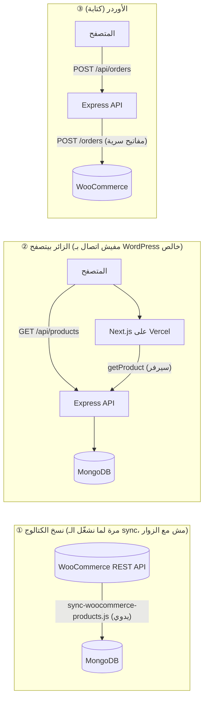

# 14. تدفّق البيانات، التحكم، والـ Caching

**آخر تحديث:** 2026-10-19. الغرض: يجاوب بدقة على: *مين بيتحكم في إيه؟ البيانات بتنتقل إمتى؟ بتتخزّن (cache) فين وكام دقيقة؟*

## 1) هل فيه Dashboard خاص بينا؟
**لأ.** مفيش لوحة تحكم (admin/backoffice) في المشروع. **لوحة التحكم هي WordPress/WooCommerce نفسها.**
اللي بنيناه 3 حاجات: (1) **واجهة المتجر** (Next.js)، (2) **API وسيط** (Express) + **نسخة قراءة** من المنتجات في MongoDB، (3) **سكريبت مزامنة**. الـ API فيه endpoint كتابة واحد بس: `POST /api/orders` (بيبعت الأوردر لـ WooCommerce).

| البند | مين بيتحكم فيه | من فين |
|---|---|---|
| المنتجات: اسم، سعر، خصم، صور، وصف، مخزون، شيدات | صاحب المتجر | WooCommerce Admin (وبتظهر على الموقع **بعد الـ sync**) |
| الأقسام والبراندات | صاحب المتجر | WooCommerce (الكود بيكمّل بتخمين لو ناقص: `03`) |
| الأوردرات (عرض، حالة، إلغاء، شحن) وإيميلات الأوردر | صاحب المتجر | WooCommerce Admin |
| العملاء | WooCommerce | (guest checkout فقط حاليًا) |
| **رسوم الشحن** | **المطوّر** | `SHIPPING_FEE` في الكود/`.env` (60 ثابت). **مش** من إعدادات الشحن في WooCommerce |
| **طرق الدفع** | **المطوّر** | كاش عند الاستلام فقط، في الكود |
| **نصوص الصفحة الرئيسية** (Hero، "Why us"، Footer) وقوايم الـ nav وشعارات البراندات وصفحة About | **المطوّر** | في كود الواجهة (`components/`، `data/`). صاحب المتجر **ما يقدرش يعدّلهم** من WordPress |
| عروض/خصومات | صاحب المتجر | سعر الخصم في WooCommerce (يظهر بعد الـ sync) |
| SEO لكل منتج (title/description/OG/JSON-LD) | آلي | من بيانات المنتج |

> **فجوة معروفة:** المحتوى الثابت في الموقع (النصوص التسويقية والـ nav) محتاج مطوّر لأي تعديل. لو صاحب المتجر عايز يعدّلها بنفسه، محتاج CMS (مثلاً صفحات WordPress عبر REST، أو headless CMS). راجع `12` A15.

## 2) تدفّق البيانات: 3 مسارات منفصلة

**الإجابة على "بيكاش داتا الووردبريس كل ما يوزر يفتح الموقع؟": لأ.** فتح الموقع **مش بيكلّم WordPress أبدًا**. الزائر بيقرا من MongoDB (عن طريق الـ API). نسخ البيانات من WooCommerce لـ MongoDB **بيحصل بس لما الـ sync يتشغّل**، وبيتشغّل **يدويًا** حاليًا (مفيش جدول زمني ولا webhooks لسه، `12` B5). وحتى الـ sync بيجيب البيانات من **WooCommerce REST API**، مش من الداتابيز بتاعة WordPress مباشرة.

## 3) طبقات الـ Cache
| # | الطبقة | بتخزّن إيه | المدة | بتتحدّث إزاي | الكود |
|---|---|---|---|---|---|
| 1 | **MongoDB (نسخة WooCommerce)** | كل الكتالوج | لحد الـ sync الجاي | تشغيل الـ sync (يدوي) | `sync-woocommerce-products.js` |
| 2 | **Express API** | **ولا حاجة**: كل طلب بيستعلم MongoDB (indexed). مفيش `Cache-Control` على `/api/products` | : | : | `routes/products.js` |
| 3 | **كاش المتصفح في الذاكرة** | ردود قوايم المنتجات وتفاصيل المنتج (Home، `/shop`، Related، Offers) | **30 ثانية**، لكل تاب، بيتمسح مع الـ refresh | تلقائي | `lib/useProducts.js` |
| 4 | **Next.js (سيرفر): صفحة المنتج** | رد `getProduct` (النجاح فقط) | **5 دقايق** (production). في التطوير: من غير كاش | تلقائي بعد 5 دقايق. `revalidateTag(\`product:slug\`)` جاهز بس **ما حدش بينادي عليه** (للـ webhooks) | `lib/getProduct.js` |
| 5 | **صور المنتجات** (`next/image`) | الصور المحسّنة | **30 يوم** (`minimumCacheTTL`) | تلقائي | `next.config.js` |
| 6 | ملفات JS/CSS | الأصول الثابتة | CDN بتاع Vercel (ملفات بـ hash) | مع كل deploy | Vercel |
| 7 | **السلة** | الأسطر المختارة | **localStorage** عند الزائر (مش على السيرفر) | الزائر | `store/useCartStore.js` |
| 8 | حالة الأوردر | : | **no-store** (عمدًا) | : | `routes/orders.js` |

**ملاحظة:** الصفحة الرئيسية و`/shop` **مش بتتجهّز على السيرفر**: الصفحة بتوصل فاضية من المنتجات والمتصفح بيجيبها من الـ API (كاش 30 ثانية). صفحة المنتج بس هي اللي بتتجهّز على السيرفر. ده بيأثّر على السرعة الأولى والـ SEO (`15`).

## 4) المنتج اتغيّر في WooCommerce، يظهر إمتى؟
مثال: السعر اتغيّر الساعة 10:00.
| الوقت | اللي بيحصل |
|---|---|
| 10:00 → أي وقت قبل الـ sync | الموقع بيعرض **السعر القديم** (النسخة في MongoDB لسه قديمة) |
| الـ sync اتشغّل 10:05 | MongoDB اتحدّث. **القوايم** (Home/Shop) تعرض الجديد خلال **30 ثانية** (أو refresh) |
| صفحة المنتج | تعرض الجديد بعد **5 دقايق** كحد أقصى من أول زيارة بعد الـ sync |
| الأوردر | **WooCommerce بيحسب الإجمالي بسعره الحي**، فلو الـ sync متأخر، إجمالي الأوردر ممكن يختلف عن اللي ظهر للعميل (السيرفر بيسجّل تحذير `total mismatch`) |

لو عايز تجبر التحديث: شغّل الـ sync. (وصفحة المنتج: استنى 5 دقايق أو `Redeploy`.)

## 5) اللي لسه مفيش
- **Webhooks** (تحديث لحظي لما المنتج/المخزون يتغيّر): ❌.
- **تشغيل الـ sync تلقائي** على الاستضافة: ❌ (دلوقتي من جهاز المطوّر): `16`.
- **CDN/HTTP caching لردود الـ API**: ❌ (كل زيارة بتضرب Render وMongoDB. ولو الخدمة نايمة: أول طلب بياخد حوالي 50 ثانية على الباقة المجانية).
